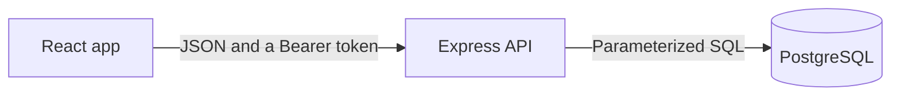

# School Management System

A full-stack web application that runs a school from Grade 1 to Grade 12: students, teachers, parents, attendance, marks and report cards, a conflict-free timetable, and fees with receipts. Each person sees only what their role allows, and the rules are enforced by the server and the database, not by the screen.

**Live demo:** coming soon

## Screenshots

<table>
  <tr>
    <td><br><sub>Dashboard</sub></td>
    <td><br><sub>Students</sub></td>
  </tr>
  <tr>
    <td><br><sub>Sections of each grade, with different sizes</sub></td>
    <td><br><sub>Attendance</sub></td>
  </tr>
  <tr>
    <td><br><sub>Entering marks</sub></td>
    <td><br><sub>Report card with rank and promotion status</sub></td>
  </tr>
  <tr>
    <td><br><sub>Timetable with teacher and room checks</sub></td>
    <td><br><sub>Invoice with partial payments</sub></td>
  </tr>
  <tr>
    <td><br><sub>Parent portal</sub></td>
    <td><br><sub>Login</sub></td>
  </tr>
</table>

## What it does

- **People:** students, teachers, parents with links to their children, and accountants. Logins are created together with the profile, or not at all.
- **Academic years:** years and semesters, copying a year, promotion with a preview, and full enrollment history. Promotion never overwrites old records, and a closed year is read-only.
- **Grades and sections:** any number of sections per grade (Grade 9 can have seven while Grade 12 has two), with a capacity for each section.
- **Attendance:** present, absent, or late by class and day, with correction.
- **Marks and report cards:** assessments with maximum marks per semester, letter grades, rank, attendance summary, promotion status, and printing to PDF. A card with missing marks shows Incomplete.
- **Timetable:** the school day, classrooms, and a weekly timetable that refuses teacher clashes, room clashes, rooms that are too small, and lessons during breaks.
- **Fees:** fee structure per grade, invoices, partial payments, numbered receipts, discounts, voids, and reports. Money records can never be edited or deleted.
- **Parent and student portals:** each sees only their own children or themselves.
- **Security:** hashed passwords, signed tokens, rate-limited login, role checks on every route, and an audit log of every change.

## Roles

| Role | Can do |
|---|---|
| Admin | Everything, including approvals (discounts, voids, cancellations), the timetable, promotion, and the audit log |
| Teacher | Attendance and marks for their own classes and subjects, reports, and timetables |
| Student | Own results, report card, attendance, and timetable |
| Parent | The same, for linked children, plus fees and receipts |
| Accountant | Fees, invoices, payments, receipts, and fee reports |

The full matrix is in [docs/PERMISSIONS.md](docs/PERMISSIONS.md).

## How it is built



| Part | Technology |
|---|---|
| Frontend | React, Vite, Tailwind CSS, React Router, Axios, Recharts |
| Backend | Node.js, Express, plain SQL with the pg driver |
| Database | PostgreSQL, with transactions, row locks, unique indexes, and triggers |
| Security | bcrypt, JWT, helmet, express-rate-limit, CORS |
| Tests | Vitest and Supertest |

Some design choices worth knowing:

- **The server decides.** Menus are hidden in the browser for convenience, but every route checks the role and who owns the data.
- **Money is protected twice.** The API refuses bad changes, and database triggers refuse them even if the API had a bug. Corrections are voids with a reason.
- **Concurrency is handled.** Two cashiers paying one invoice, or two admins booking one teacher, cannot both succeed when only one should.
- **History is added, never overwritten.** Promotion adds an enrollment row.

More detail: [docs/ARCHITECTURE.md](docs/ARCHITECTURE.md).

## Run it locally

You need Node.js (a recent version) and PostgreSQL.

### 1. Database

```bash
createdb school_management
psql -d school_management -f database/schema.sql
```

You can also create the database in pgAdmin and run `database/schema.sql` in its Query Tool.

### 2. Backend

```bash
cd backend
npm install
cp .env.example .env
```

Open `backend/.env` and fill in your PostgreSQL password and a long random `JWT_SECRET` (at least 16 characters; the server refuses to start without one). Then:

```bash
npm run dev
```

The API runs on http://localhost:5000.

### 3. The first admin

Make a password hash and insert the admin (replace the password and paste the hash):

```bash
node -e "console.log(require('bcrypt').hashSync('YourStrongPassword', 10))"
```

```sql
INSERT INTO users (email, password_hash, role)
VALUES ('admin@school.com', 'PASTE_THE_HASH_HERE', 'admin');
```

### 4. Frontend

```bash
cd frontend
npm install
cp .env.example .env
npm run dev
```

The app runs on http://localhost:5173. Log in with the admin you just created.

### Optional: demo data

`node tools/seed-demo.js` builds a separate database named `school_management_demo` with invented students, teachers, marks, attendance, fees, and a timetable. Run the backend on it with `DB_NAME=school_management_demo npm run dev` and log in as `admin@demo.school` with the password `Demo12345`. Stop the backend before seeding.

## Tests

```bash
cd backend
npm run test:db
npm test
```

`npm run test:db` builds a separate database named `school_management_test` from your local one. Stop the backend before running it. The tests wipe that database and refuse to run on any database whose name does not end in `_test`. There are more than 400 backend tests, covering authentication, a role-by-endpoint matrix, marks and report cards, promotion, parents, fees, the timetable, and concurrency.

## Documentation

| Document | What it holds |
|---|---|
| [docs/SRS.md](docs/SRS.md) | Requirements, each marked implemented, partial, or planned, and a comparison with the original brief |
| [docs/ARCHITECTURE.md](docs/ARCHITECTURE.md) | Structure, request flow, security layers, and deployment |
| [docs/API.md](docs/API.md) | Every endpoint and who may call it (generated from the code) |
| [docs/PERMISSIONS.md](docs/PERMISSIONS.md) | The role matrix and data-scope rules (generated) |
| [docs/DATABASE.md](docs/DATABASE.md) | ER diagrams and a data dictionary (generated from the database) |

Regenerate the generated documents with `node tools/gen-docs.js`.

## Project structure

```
backend/     Express API, middleware, routes, and tests
frontend/    React app
database/    schema.sql builds an empty database
docs/        documentation and screenshots
tools/       documentation generators, a schema check, and the demo seed
```

## Limits

This is a portfolio project, not a finished product for a real school. Be aware of these:

- **Section capacity is shown, not enforced.** A full section still accepts students.
- **The grading scale is fixed in the code** (A from 90, B from 80, and so on).
- **Marks are visible to parents and students as soon as a teacher saves them.** There is no approval step.
- **A plain student delete removes the student's own marks and attendance.** Students with invoices are protected, and graduated students are kept.
- **A login token stays valid until it expires**, even if the account is deleted.
- **There are no frontend tests and no browser end-to-end tests.**

## Planned

Admissions, a library, discipline records, email and SMS notifications, homework, a result approval workflow, staff attendance and leave, payroll, and an automatic timetable generator. See the coverage table in [docs/SRS.md](docs/SRS.md).

## Author

Your Name, final-year software engineering student.