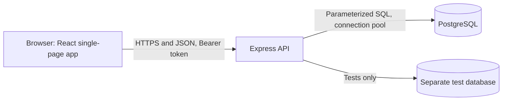
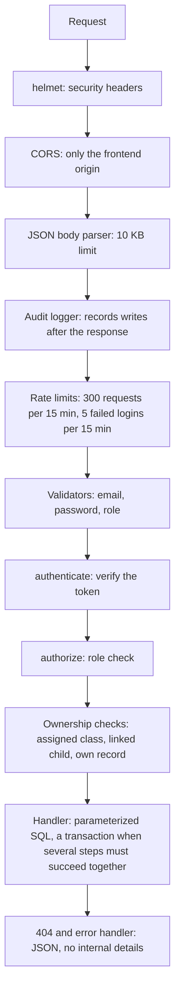
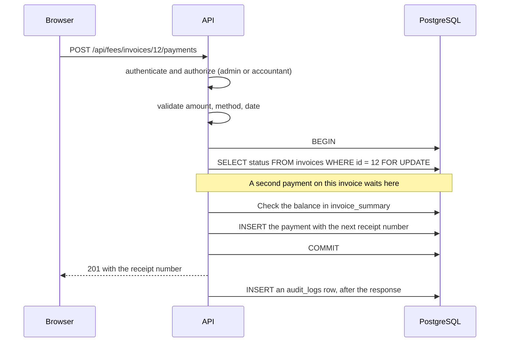
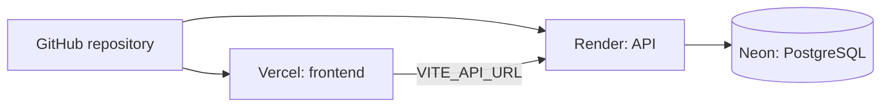

# Architecture

## 1. Overview



The frontend and the backend are separate projects. The browser talks only to the API. The API is the only thing that talks to the database, and it enforces every rule. The frontend hides menu items for convenience, but that is never the protection.

## 2. Technology

| Part | Used |
|---|---|
| Frontend | React, Vite, Tailwind CSS, React Router, Axios, Recharts, Lucide icons, plain JavaScript |
| Backend | Node.js, Express, the pg driver with hand-written SQL |
| Database | PostgreSQL |
| Security libraries | bcrypt, jsonwebtoken, helmet, express-rate-limit, cors |
| Tests | Vitest and Supertest |
| Hosting | Vercel (frontend), Render (API), Neon (database) |

### Differences from the original brief

| Brief | Built | Reason |
|---|---|---|
| TypeScript, Prisma | JavaScript, plain SQL | The project was built step by step by a learner. Plain SQL made transactions, row locks, and triggers explicit, and every query can be read in one place. Moving to Prisma would add no feature. |
| shadcn/ui, TanStack Query, React Hook Form, Zod | Tailwind, a small set of shared components, React state, server-side validation | Fewer dependencies. These can be adopted one at a time. |
| Swagger or OpenAPI | A generated API.md | It is built from the route files, so it cannot drift. |
| Playwright end-to-end tests | Not built | The backend rules carry the risk, so they were tested first. |
| Server-side PDF, Multer uploads, Nodemailer | Not built | Printing uses the browser. There are no uploads or emails yet. |

## 3. Backend structure

```
backend/
  src/
    app.js            builds the Express app, so tests can load it without opening a port
    server.js         checks the secret, then listens on a port
    config/db.js      one connection pool, local settings or DATABASE_URL
    middleware/       auth.js, validate.js, audit.js
    routes/           one file per module
    utils/            yearGuard.js
  tests/              Vitest and Supertest
database/schema.sql   builds an empty database
tools/                documentation generators and checks
docs/                 this folder
```

Each route file holds the endpoints, the permission checks, and the SQL of one module. The business rules are in the route handlers. There is no separate service layer because the modules are small, and splitting them would only spread the rules over more files.

## 4. Request lifecycle



## 5. Example: recording a payment



## 6. Data integrity

- **Transactions:** creating a student, a teacher, or a parent (login and profile), promotion, copying a year, generating invoices, and recording a payment all run in one transaction, so a failure leaves nothing half done.
- **Locks:** a payment locks its invoice row. A timetable change takes a per-year advisory lock. Two cashiers or two administrators acting together cannot both succeed when only one should.
- **Constraints:** unique constraints and indexes stop duplicate attendance, marks, enrollments, timetable slots, teacher bookings, and room bookings, even if an application check is skipped.
- **Triggers:** enrollments follow a student's class. Timetable lessons follow a teacher assignment. Financial records cannot be edited or deleted.
- **Calculated, not stored:** invoice totals and balances are computed from the item and payment rows, so they cannot drift.

## 7. Security layers

| Layer | Protection |
|---|---|
| Passwords | bcrypt hashes, 8 to 72 characters |
| Login | A signed token that lasts one day. The server refuses to start without a long secret. Five failed logins per 15 minutes per IP. |
| Authorization | A role check on every route, then ownership checks (assigned class, linked child, own record) |
| Input | Validation, parameterized SQL, a body size limit, and no role chosen from the request body |
| Transport and headers | helmet, CORS limited to the frontend, HTTPS on the hosts |
| Output | No password hashes in any response. Errors never include internals. |
| Accountability | An audit log of writes and failed logins |

## 8. Frontend structure

```
frontend/src/
  main.jsx            mounts the app with the router and the feedback provider
  App.jsx             routes, a protected-route wrapper, and role-based home pages
  api.js              one Axios instance, adds the token, sends the user to login when it expires
  components/         Layout (sidebar and top bar), Feedback (toasts and confirm dialogs), Modal, shared views
  pages/              one file per screen
  utils/money.js      money formatting and status colors
```

The sidebar is built from one list of items with the roles that may see each. Printing hides the sidebar and the controls with Tailwind print classes.

## 9. Deployment



| Setting | Where |
|---|---|
| DATABASE_URL, JWT_SECRET, FRONTEND_URL | Render environment variables |
| VITE_API_URL | Vercel environment variable |
| The database structure | database/schema.sql, checked by tools/check-schema.js |

A free API host sleeps when idle, so the first request after a quiet period takes about a minute.

## 10. Testing

About 400 backend tests run with `npm test` against a separate database whose name must end in _test. A helper wipes that database before each file and refuses to run on any other name. Concurrency tests fire two requests at once and expect exactly one winner.

## 11. Key decisions

1. **The API enforces everything.** The frontend only hides what a role cannot use.
2. **Money is protected twice.** The API refuses bad changes, and database triggers refuse them even if the API has a bug.
3. **History is added, never overwritten.** Promotion adds an enrollment row. Corrections to money are voids with a reason.
4. **The app is split from the server.** Tests load the app directly, with no network port.
5. **Documents are generated.** The API list, role matrix, and database diagrams come from the code and the database, so they stay true.