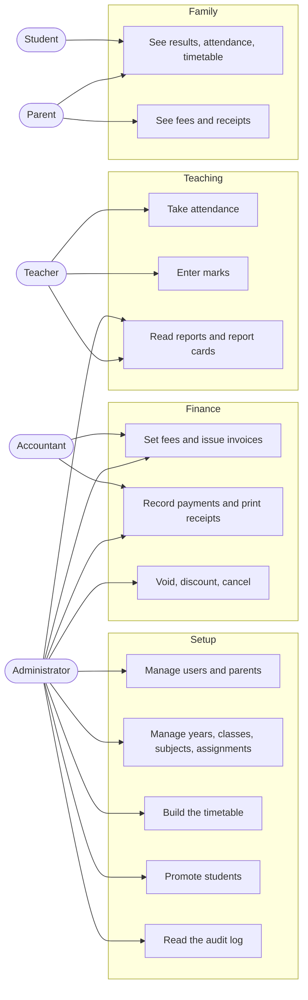

# Software Requirements Specification

School Management System for Grades 1 to 12

Version 1.0, November 2026

Every requirement carries one of three statuses: **Implemented** (built and working), **Partial** (built with the limits stated), or **Planned** (not built). Section 9 shows which parts have automated tests.

## 1. Introduction

### 1.1 Purpose

This document describes what the system does, who uses it, the rules it enforces, and what is not built yet. It is written from the code that exists. The original project brief was larger than what has been built, so section 7 compares the two.

### 1.2 Scope

One school that teaches Grades 1 to 12. The system covers people (students, teachers, parents, accountants), classes and academic years, attendance, assessment and report cards, the timetable, and fees. It does not cover several operational modules, listed in section 7.

### 1.3 Related documents

- API.md: every endpoint and who may call it
- PERMISSIONS.md: the role matrix and data-scope rules
- DATABASE.md: entity-relationship diagrams and data dictionary
- ARCHITECTURE.md: structure, security layers, and deployment

## 2. Overall description

### 2.1 Users

| Actor | What they do | Status |
|---|---|---|
| Administrator | Sets up the school: users, classes, subjects, assignments, years, assessments, timetable, announcements. Approves discounts, voids, and cancellations. Reads the audit log. | Implemented |
| Teacher | Takes attendance and enters marks for their own classes. Reads reports, report cards, and timetables. | Implemented |
| Student | Reads their own results, report card, attendance, and timetable. | Implemented |
| Parent or guardian | Reads results, attendance, report cards, timetable, and fees of their linked children. | Implemented |
| Accountant | Sets fees, issues invoices, records payments, prints receipts, and reads fee reports. | Implemented |
| School director, registrar, academic director, department head, librarian, store manager, receptionist | Named in the original brief. | Planned (the administrator role covers the first three) |

### 2.2 Operating environment

A web application used from a browser on desktop, tablet, or phone. The frontend is a React single-page app. The backend is a Node.js and Express API. Data is stored in PostgreSQL.

### 2.3 Assumptions

The brief asked for policies to be configurable and for assumptions to be stated. These are the assumptions in the code today:

| Assumption | Where it lives | Configurable? |
|---|---|---|
| The school year runs September to June, with two semesters | Dates are suggested when a year is created | Yes, all dates are editable |
| A semester is worth 100 marks: Individual Assignment 10, Group Assignment 10, Mid Exam 30, Final Exam 50 | Assessments table | Yes, assessments are added, removed, and re-weighted per year |
| Letter grades: A from 90, B from 80, C from 70, D from 60, otherwise F | Code | **No**, fixed in the code |
| Pass mark is 50 percent | Promotion screen and report card code | Partly: the promotion screen has a field, the report card uses a constant |
| Lessons run Monday to Saturday, one bell schedule for the whole school | Timetable setup | Periods and breaks are editable. The days are fixed |
| Currency is ETB | School settings | Yes |
| Classes are Grade 1 to 12 with sections A to D | Seed data and year copy | Yes, sections are rows in the classes table |

## 3. Use cases

### UC-1 Take attendance

1. The teacher opens Attendance and sees only the classes where they teach a subject in the active year.
2. They choose a class and a date. Students load with any saved status.
3. They mark each student present, absent, or late and save.
4. Saving again for the same day corrects the record. It never creates a second one.

Refused: a class that is not theirs, a student who is not in the class, a closed academic year.

### UC-2 Record a payment

1. The accountant opens an invoice and enters an amount, a method, and an optional reference.
2. The server locks the invoice, checks the amount against the balance, and stores the payment with the next receipt number.
3. The invoice shows partial or paid, and the receipt can be printed.

Refused: an amount above the balance (even if two cashiers pay at once), a cancelled invoice, a future date.

### UC-3 Promote students

1. The administrator creates the next academic year and copies the classes.
2. On the Promotion screen they choose the two years and load the students. Each student gets a suggestion from the full-year result.
3. They change any decision and apply. All decisions run in one transaction.
4. Each student gets a new enrollment in the new year. The old enrollment and all marks stay.

Refused: a student with no matching class in the new year (nothing changes), promoting a Grade 12 student, promoting into a closed year.

### UC-4 Schedule a lesson

1. The administrator opens a class timetable and clicks a cell.
2. They choose a subject. The teacher comes from the teacher assignment. They may choose a room.
3. The server checks the break, the assignment, the teacher's other lessons, the room's other lessons, and the room's capacity.

Refused: any clash, with a message that names the other class.

## 4. Functional requirements

### 4.1 Accounts and security

| ID | Requirement | Status |
|---|---|---|
| AUTH-1 | Log in with email and password. A token lasts one day. | Implemented |
| AUTH-2 | Passwords are 8 to 72 characters and stored as bcrypt hashes. | Implemented |
| AUTH-3 | Five failed logins per 15 minutes per IP address are allowed, then login is blocked. | Implemented |
| AUTH-4 | Any user can change their own password with the current password. | Implemented |
| AUTH-5 | An administrator can reset the password of a student, teacher, parent, or accountant. | Implemented |
| AUTH-6 | Role checks run on the server for every protected endpoint. | Implemented |
| AUTH-7 | Every create, update, and delete is written to an audit log, with failed logins. Passwords are never stored in it. The administrator can browse it. | Implemented |
| AUTH-8 | Forgot-password by email. | Planned |
| AUTH-9 | Deactivate an account without deleting it, and revoke sessions. | Planned |
| AUTH-10 | Granular permissions stored in the database (role, permission, and role-permission tables). | Planned. Roles are checked in code. |

### 4.2 People

| ID | Requirement | Status |
|---|---|---|
| STU-1 | Register a student. The login, the profile, and the first enrollment are created together or not at all. | Implemented |
| STU-2 | Edit, search by name, filter by grade and section, sort, and page through students. Moving a student to another section updates the enrollment. | Implemented |
| STU-3 | Delete a student. This is refused when the student has invoices. | Implemented |
| STU-4 | Show a student's enrollment history across years. | Implemented |
| STU-5 | Graduated students are kept and hidden from the active list. | Implemented |
| STU-6 | A withdrawn status. | Partial. The status exists in the database but has no screen. |
| STU-7 | Student ID number, photograph, documents, previous school, guardian details on the student form, and transfers to another school. | Planned |
| TCH-1 | Register, edit, and delete teachers. | Implemented |
| TCH-2 | Assign a teacher to a subject in a class. One teacher per subject per class. | Implemented |
| TCH-3 | Qualifications, departments, employee numbers, staff attendance, leave, and payroll. | Planned |
| PAR-1 | Register parents and link them to children. A parent can have several children and a child several parents, with a relationship. | Implemented |
| PAR-2 | A parent portal: children, results, attendance, report cards, timetable, fees, and receipts. | Implemented |
| PAR-3 | Messages between parents and teachers, and notifications. | Planned |

### 4.3 Academic structure

| ID | Requirement | Status |
|---|---|---|
| YR-1 | Create academic years with two semesters, edit their dates, and copy classes, assignments, and assessments from an earlier year. | Implemented |
| YR-2 | Only one year is active. Activating a year closes the previous one. | Implemented |
| YR-3 | A closed year is read-only for attendance, marks, timetable, fee setup, and new invoices. | Implemented |
| YR-4 | Promotion with a preview, a configurable pass mark, per-student decisions, and one transaction. Old enrollments and marks are kept. | Implemented |
| CLS-1 | Grades 1 to 12 with any number of sections per year. | Partial. Sections come from the seed data and from copying a year. The API can add a class but there is no screen. |
| CLS-2 | Class capacity, class teacher, and assigning classrooms to a class. | Partial. Rooms have a capacity that is checked in the timetable. There is no class teacher. |
| SUB-1 | Create and delete subjects and assign them to classes. | Implemented |
| SUB-2 | Subject codes, compulsory or elective subjects, subject weights, and learning materials. | Planned |

### 4.4 Attendance

| ID | Requirement | Status |
|---|---|---|
| ATT-1 | Record present, absent, or late by class and day, in bulk, with correction. One record per student per day. | Implemented |
| ATT-2 | Attendance counts feed the dashboard, the report card, and the parent portal. | Implemented |
| ATT-3 | An excused status, subject-based attendance, monthly reports, and absence notifications. | Planned |
| ATT-4 | Teacher attendance. | Planned |

### 4.5 Assessment and report cards

| ID | Requirement | Status |
|---|---|---|
| EXM-1 | Define assessments per year and semester with a maximum mark. The page warns when a semester does not add up to 100. | Implemented |
| EXM-2 | Enter marks by class, subject, and assessment. A mark must be between 0 and the maximum. Saving again replaces the old mark. | Implemented |
| EXM-3 | Subject reports with every assessment, the total, and the letter grade. A class summary for administrators. | Implemented |
| EXM-4 | A grading scale that the school can configure by year, grade, and subject. | Partial. One fixed scale in the code. |
| EXM-5 | Submit and approve results, and lock approved results. | Planned. Marks are visible to students and parents as soon as they are saved. |
| RC-1 | A report card with every subject and assessment, totals, letter grades, average, rank, attendance summary, and promotion status. A card with missing marks shows Incomplete. | Implemented |
| RC-2 | Print or save as PDF from the browser, for staff, students, and parents. | Implemented |
| RC-3 | School logo, teacher and principal comments, and PDF generation on the server. | Planned. The card has blank signature lines. |

### 4.6 Timetable

| ID | Requirement | Status |
|---|---|---|
| TT-1 | Build the school day from a start time, lesson length, number of lessons, and breaks. Edit periods one by one. | Implemented |
| TT-2 | Manage classrooms with an optional capacity and an active flag. | Implemented |
| TT-3 | Schedule a lesson per class, day, and period. The teacher comes from the teacher assignment. | Implemented |
| TT-4 | Refuse teacher clashes, room clashes, rooms that are too small, lessons in breaks, unassigned subjects, and closed years. | Implemented |
| TT-5 | Class, teacher, student, and parent views, printable. | Implemented |
| TT-6 | Automatic timetable generation, week A and B, substitutes, and teacher unavailability. | Planned |

### 4.7 Fees and finance

| ID | Requirement | Status |
|---|---|---|
| FEE-1 | Fee types and an amount per grade, per type, per year. A configurable currency. | Implemented |
| FEE-2 | Generate one invoice per active enrolled student from the fee structure, skipping students who already have one. Create custom invoices. | Implemented |
| FEE-3 | Record full or partial payments with a method and reference. A payment never exceeds the balance. | Implemented |
| FEE-4 | Numbered receipts, printable, also for parents. | Implemented |
| FEE-5 | Discounts need an administrator and a reason. Voiding a payment and cancelling an invoice need an administrator and a reason. | Implemented |
| FEE-6 | Payments and invoices cannot be edited or deleted, even directly in the database. | Implemented |
| FEE-7 | Fee reports: invoiced, collected, outstanding, collection rate, by grade, by method, and the largest balances with parent phone numbers. | Implemented |
| FEE-8 | Scheduled installment plans, scholarships as records, refunds with approval, reminders, and online payment providers. | Planned |

### 4.8 Communication and reporting

| ID | Requirement | Status |
|---|---|---|
| COM-1 | The administrator posts announcements and everyone reads them. | Implemented |
| COM-2 | Email, SMS, and in-app notifications. | Planned |
| RPT-1 | A dashboard with counts, today's attendance, students per grade, grade distribution, and gender distribution. Teachers see only their classes. | Implemented |
| RPT-2 | Admission, demographic, promotion, and graduation reports. | Planned. The promotion preview covers part of this. |

## 5. Business rules

| ID | Rule | Enforced by |
|---|---|---|
| BR-1 | Only one academic year is active. | Database partial unique index |
| BR-2 | A closed year is read-only. | API checks |
| BR-3 | A mark is at least 0 and at most the assessment maximum. | API check |
| BR-4 | A student has one attendance record per day, and one mark per subject and assessment. | Database unique constraints |
| BR-5 | A student has one enrollment per year. Promotion adds a row and never overwrites. | Database unique constraint and trigger |
| BR-6 | A teacher sees only their own classes and subjects. | API checks |
| BR-7 | A parent sees only linked children. A student sees only themselves. | API checks on every route |
| BR-8 | A report card is Incomplete until every mark of every assigned subject is entered. | API logic |
| BR-9 | Tied students share a rank. | API logic |
| BR-10 | Promotion runs in one transaction. Only Grade 12 students graduate. | API logic |
| BR-11 | A teacher cannot be in two classes at once. A room cannot be double-booked or too small. No lessons in a break. | API checks inside a locked transaction, and database unique indexes |
| BR-12 | A payment cannot exceed the invoice balance, even when two arrive together. | Row lock inside a transaction |
| BR-13 | Payments and invoices are never edited or deleted. Corrections are voids and cancellations with a reason. | Database triggers |
| BR-14 | A discount cannot exceed the invoice total or drop it below what was paid. | API check |
| BR-15 | A student with invoices cannot be deleted. | Foreign key |
| BR-16 | Every write is audited. | Middleware |

## 6. Non-functional requirements

| Area | Requirement | Status |
|---|---|---|
| Security | Passwords hashed with bcrypt. Tokens signed with a secret that must be set at startup. Parameterized SQL everywhere. Security headers. CORS limited to the frontend. Body size limit. Rate limiting. Server-side role and ownership checks. | Implemented |
| Data integrity | Foreign keys, unique constraints, check constraints, transactions, row locks, and triggers. | Implemented |
| Auditability | An audit log of writes, and permanent financial records. | Implemented |
| Usability | Responsive layout, toasts, confirmation dialogs, loading and empty states, printable pages. | Implemented |
| Maintainability | A modular backend, about 400 automated backend tests, and API, permission, and database documents generated from the code. | Implemented |
| Performance | Designed for one school with a few hundred students. Most lists are not paged on the server. No load testing has been done. | Partial |
| Availability | Depends on the host. A free host sleeps when idle. | Partial |
| Backup and recovery | Relies on the database host. There is no backup feature in the app. | Planned |
| Accessibility and translation | Not audited. English only. | Planned |

## 7. Coverage of the original brief

| # | Module in the brief | Status |
|---|---|---|
| 1 | Authentication and user management | Partial |
| 2 | Student management | Partial |
| 3 | Admission management | Planned |
| 4 | Grades, sections, and classrooms | Partial |
| 5 | Teacher and staff management | Partial |
| 6 | Academic year and semester management | Implemented |
| 7 | Subjects and curriculum | Partial |
| 8 | Student attendance | Partial |
| 9 | Teacher attendance | Planned |
| 10 | Examination and assessment | Partial |
| 11 | Report cards | Partial |
| 12 | Timetable | Implemented |
| 13 | Homework and assignments | Planned |
| 14 | Fees and finance | Partial |
| 15 | Parents and guardians | Partial |
| 16 | Library | Planned |
| 17 | Discipline | Planned |
| 18 | Communication and notifications | Partial (announcements only) |
| 19 | Reports and analytics | Partial |
| 20 | Additional operations (calendar, inventory, transport, visitors, payroll, alumni, backups) | Planned |

The brief also named a different technology stack. See ARCHITECTURE.md for the differences and the reasons.

## 8. Known limitations

- Deleting a student who has no invoices also deletes their marks, attendance, and enrollments. The brief says historical records must be kept. Graduated students are kept, and students with invoices are protected, but a plain delete is destructive.
- Marks are visible to parents and students as soon as a teacher saves them.
- A login token stays valid until it expires, even if the account is deleted.
- Rate-limit counters live in server memory, so they reset on restart.
- The token is stored in the browser's local storage. A production system would use httpOnly cookies.
- Past academic years cannot be browsed in the screens. Their data is kept, and a student's profile shows the enrollment history.
- Lists such as students and teachers are not paged on the server.
- The grading scale is fixed in the code.
- A teacher can read any class timetable.
- There are no automated tests for the frontend and no browser end-to-end tests.

## 9. Test coverage

| Test file | What it covers |
|---|---|
| validate.test.js | Email, password, and role validation |
| auth.test.js | Login, token handling, registration, password change |
| ratelimit.test.js | The login limit |
| security.test.js | Every endpoint against every role, HTTP hardening, injection, mass assignment, and the audit log |
| students.test.js | Registration, listing, updates, deletion, and enrollments |
| attendance.test.js | Class access, saving, corrections, closed years |
| grades.test.js | Mark limits, access rules, what students see |
| results.test.js | Grade boundaries, pass mark, rank, report card access, reports |
| years.test.js | Years, copying, promotion, history, closing |
| parent.test.js | Parent accounts, links, and access limits |
| fees.test.js | Fee setup, invoices, payments, voids, database protection, parent fees, reports, accountants |
| timetable.test.js | The school day, rooms, every clash rule, concurrency, and visibility |

Not covered by automated tests: announcements as a feature, the dashboard figures, the fine detail of the audit log, and all frontend behavior. These were checked by hand.